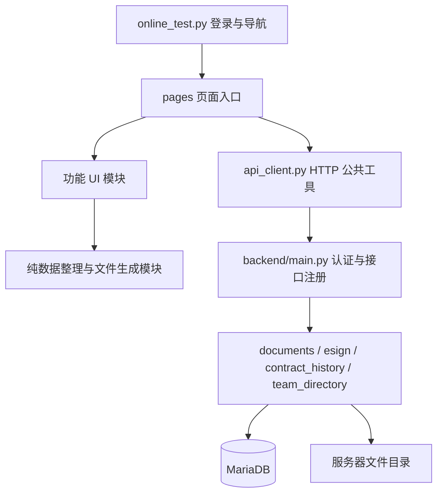

# 脚本职责与应用入口

新增入口（2026-10-14）：`frontend/index.html` → `frontend/src/main.tsx` → `frontend/src/App.tsx` 为 React 带薪假试点，默认连接 `backend/leave_preview.py` 的独立本地数据库；正式业务路由由 `backend/main.py` 注入认证及 MariaDB 连接。规则、存储、接口分别放在 `backend/leave_rules.py`、`backend/leave_store.py`、`backend/leave_requests.py`。详见 [试点模块说明](leave-pilot.md)。旧 Streamlit 入口继续保留，此新模块尚未部署。

本文解释程序怎样启动、脚本如何协作，以及本次 Mon équipe 拆分。按功能查文件时，先读 [模块索引](modules.md)。

## 1. 两个总入口

| 入口 | 执行方式 | 负责什么 |
| --- | --- | --- |
| `online_test.py` | `python -m streamlit run online_test.py` | 页面配置、登录恢复、角色导航、执行选中的页面。名称保留历史兼容，实际是正式前端入口 |
| `backend/main.py` | 本地包导入 `backend.main`；服务器 `uvicorn main:app` | 创建 FastAPI、读取环境配置、连接数据库、认证和组织权限、注册功能接口及启动迁移 |

前端不直接连接数据库。前端通过 `api_client.py` 携带登录令牌请求后端，最终访问权限由后端判断。生产前端目录为 `/var/www/presence-interface`，后端目录为 `/var/www/presence-app`。密钥保留在服务器环境配置中。

## 2. Mon équipe：读取、整理、展示分开

| 脚本 | 职责 | 直接依赖 |
| --- | --- | --- |
| `pages/People.py` | 检查登录，按角色选接口，组织页面；不拼 SQL、不生成卡片 HTML | `access_control`、`team_api`、`team_ui`、`organization_ui` |
| `team_api.py` | 发起带认证的读取请求，统一显示接口错误 | `api_client`、Streamlit |
| `team_ui.py` | 将已授权的人员数据转为表格，并展示空列表状态 | `access_control`、Streamlit |
| `organization_model.py` | 纯数据投影：活跃部门、负责人、成员、未分配名单及旧数据冲突提示；无 HTTP、数据库或 Streamlit 依赖 | Python 标准库 |
| `organization_cards.py` | HTML 转义和响应式卡片：宽屏三列、中屏两列、窄屏一列；无部门连线 | Python 标准库 |
| `organization_ui.py` | 默认折叠的架构区域、人数、卡片、未分配名单、冲突提示；无接口请求或虚构数据 | `organization_model`、`organization_cards`、Streamlit |
| `organization_chart.py` | 旧导入路径兼容层，实际逻辑转到 `organization_model.py` | `organization_model` |
| `backend/team_directory.py` | 只读 SQL 查询、基础字段投影、两个接口注册；数据库与认证依赖由总入口注入 | FastAPI；不反向导入 `main.py` |

请求流程：

1. 登录后进入 Mon équipe，读取 `/organization-directory`，显示全公司基础架构。架构默认收起。
2. 普通员工读取 `/my-team`；后端从当前登录账号的活跃部门归属查询同组名单，客户端不能指定其他账号或部门扩大范围。
3. Admin、Manager 沿用 `/list-users` 与 `/groups` 的原授权范围，保留现有人员表格。
4. 接口失败时显示错误；不会用不完整的人员数据伪装成全公司架构。

新目录不返回完整邮箱、合同、密码、令牌或财务文件。不增加员工修改权限，也不改变考勤负责人和双签规则。未填写姓名的展示采用邮箱 `@` 前部分；现有目录接口目前只提供该显示名。

## 3. 本地预览与正式功能隔离

`.local-test/organization_preview.py` 是独立预览入口，读取本地只读快照，不接生产 API；账号选择仅模拟名单，不是鉴权测试。虚构布局数据在 `.local-test/organization_fixture.py`，不被正式页面导入，也不部署。该目录、快照和截图被 Git 忽略。

早期 `organization_echarts.py`、`organization_zoom.js` 属于停用的树图原型，不在正式入口依赖链中。本次卡片界面不加载 ECharts。`streamlit-echarts` 暂保留供历史原型复现。

## 4. 其他脚本的阅读顺序

| 功能 | 页面入口 | 下一层脚本 |
| --- | --- | --- |
| 考勤 | `pages/Fiches.py` | `fiche_exports.py` 校验生成；`fiche_batch_ui.py` 勾选；`fiche_serialization.py` 保存转换 |
| 日历及月份 | 考勤、Documents 页面 | `calendar_view.py`、`planning.py`、`period_selector.py` |
| 合同 | `pages/Admin.py`、考勤页面 | `contract_ui.py`、`contract_periods.py`、`backend/contract_history.py` |
| Documents | `pages/TransportReceipts.py` | `document_ui.py` 操作；`document_downloads.py` ZIP；`backend/documents.py` 存储与权限 |
| Excel / Word | `fiche_exports.py` | `ExcelGen.py`、`DocxGen.py` 和各自模板 |
| PDF / 双签 | `pdf_export.py`、考勤页面 | `backend/esign.py` 转换发送；`signature_flow.py` 签署人；`signature_placement.py` 签名位置 |
| 人员和组织维护 | `pages/Admin.py` | `backend/main.py` 对应组织接口 |
| 登录和个人资料 | `pages/Login.py`、`pages/Profile.py` | `api_client.py`、`remember_me.py`、后端认证与资料接口 |
| 仪表板及提醒 | `pages/Dashboard.py` | `backend/main.py` 对应提醒与面谈接口 |

`backend/main.py` 仍包含认证、组织管理和提醒，尚未全部拆分。继续拆分时应保持接口路径、权限依赖和旧数据兼容；不需要为一个页面通读整个入口。

## 5. 测试、发布与当前边界

本次新增 `test_team_directory.py`：检查未登录拒绝、三类角色读取、本人部门范围、防止查询参数越权、字段裁剪、数据库连接释放、HTML 转义、冲突数据保留及页面分支。测试使用模拟 API/数据库，无真实上传、邮件或签署。

执行完整回归：`python -m unittest discover -v`。生产发布还需比较服务器差异、备份被替换的源码和 MariaDB、验证平铺模块导入、重启服务并检查健康状态。详细发布记录见 [重构记录](refactoring.md)。

当前是只读展示升级。测试账号的持久化标记/公开隐藏、单部门归属与单负责人强制约束、负责人变更自动调整权限仍待实现；旧冲突数据只提示，不删除。新模块没有数据库结构迁移。
