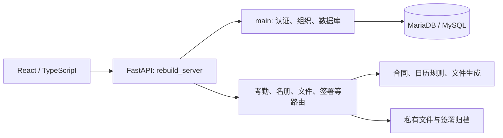

# 应用入口与依赖

## 当前应用

- React：`frontend/src/main.tsx` → `App.tsx` → `AppWorkspace.tsx`。页面职责与工具栏入口见 [模块索引](modules.md)。
- 线上 API：`backend/rebuild_server.py`，8015，复用 `backend/main.py`；保留 API 8001 仍支持 flat 导入，同样执行会话和角色保护。
- 本地副本：`backend/local_rebuild.py`，8013；独立数据库 3307。Windows 启动入口为 `scripts/start_local_rebuild.ps1`，前端 5173。
- `calendar_view.py` 只保留半天状态读取/修改及旧 JSON 数据兼容规则，React API 直接复用；没有 Streamlit 渲染与组件依赖。
- `contract_periods.py`、`planning.py`、`fiche_exports.py`、`fiche_serialization.py`、`ExcelGen.py`、`DocxGen.py`、`document_downloads.py`、`organization_model.py` 仍是活动共用逻辑。

## 员工名册前端

- `PersonnelEditor.tsx` 编辑基本资料；`EmploymentEditor.tsx` 通过 `EmploymentFields.tsx` 编辑任职与特殊情况。
- 同一文件中的 ContractFields 与 SpecialEmploymentFields 组合完整表单，也支持直接编辑三类身份。
- `PersonnelInformation.tsx` 共用只读基本资料和 EmploymentSummary；字段标签及前端必填提示集中在 `personnelValidation.ts`。
- `SensitiveNumber.tsx` 继续独立负责权限控制下的短时查看，普通资料组件不请求或缓存 NIR。
- `useRegistryAction.ts` 保留提交锁、错误/版本冲突处理和查询失效；权限、条件校验与事务审计仍由后端执行。

## 安装与环境

- `requirements.txt`：当前程序直接依赖，包含 `backend/requirements.txt`；生产不默认安装 Streamlit 的界面及其依赖树。
- `requirements-dev.txt`：开发所需的现有 FastAPI TestClient 依赖；测试文件与生产业务逻辑分别保留。
- `frontend/package-lock.json` 与 `npm ci`：前端依赖。
- Devcontainer 只准备 Python 后端环境，不自动启动旧界面；React 开发另需 Node/npm 和有效的本地 API 配置。
- 密钥、数据库、文件目录及系统服务见 [后端部署说明](../backend/README.md)，不放入源码或备案包。

## 旧版备案与恢复

[备案目录](../archive/streamlit/README.md) 包含完整源码 ZIP、SHA-256 清单和恢复命令，Git 标签为 `archive/streamlit-20261023`，基线提交 `de055e8`。旧入口 `online_test.py`、`pages/` 及其辅助模块仅在该快照内维护。

备案恢复到新的独立目录，可使用当前本地 API 查阅旧界面。根目录的历史文档出现旧路径时，均以此快照为定位依据。

此次整理未停止线上 Streamlit、保留 API 或修改 Nginx；它们运行在独立部署目录。源码备案不能替代数据库/私有文件备份，生产发布和回退仍按现有部署流程执行。
